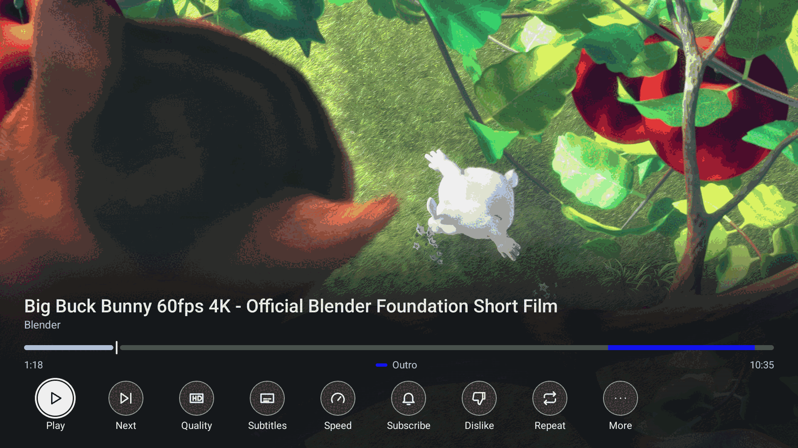
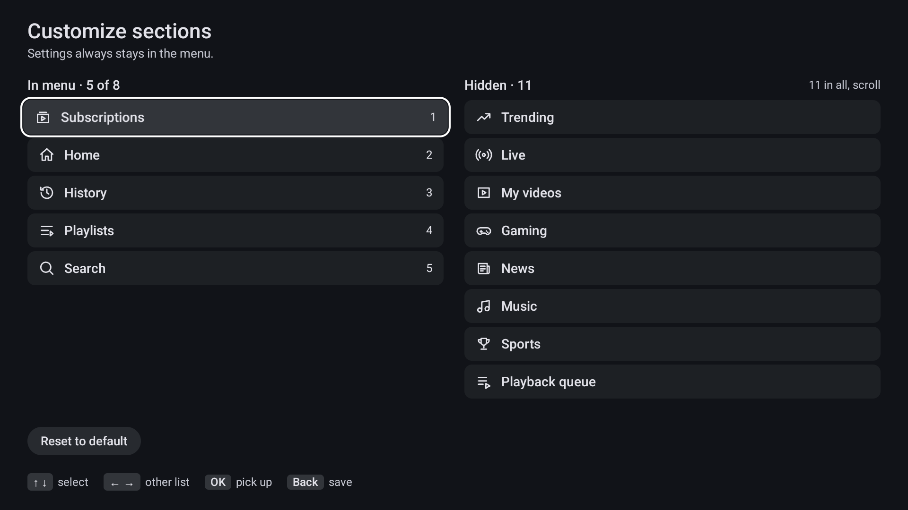
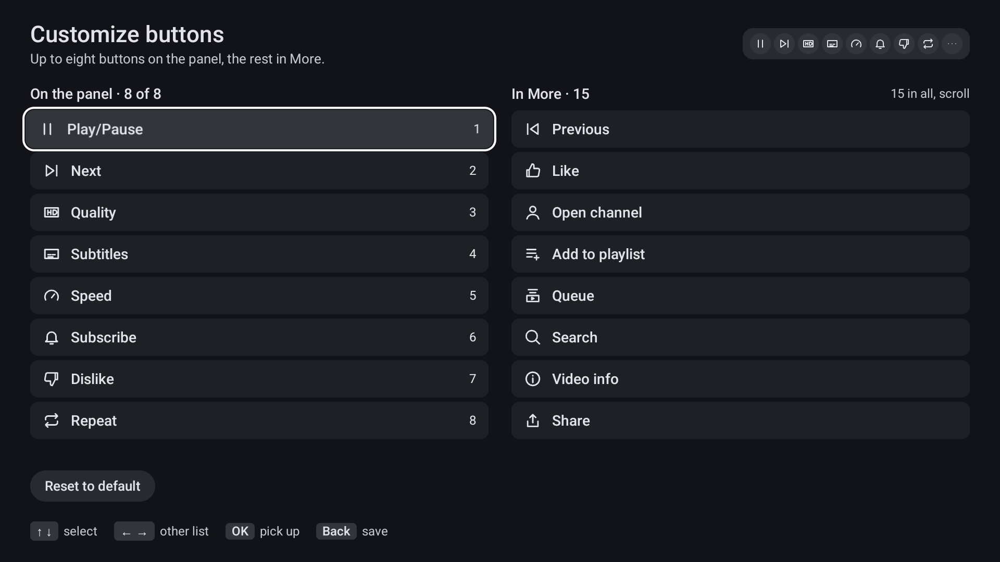
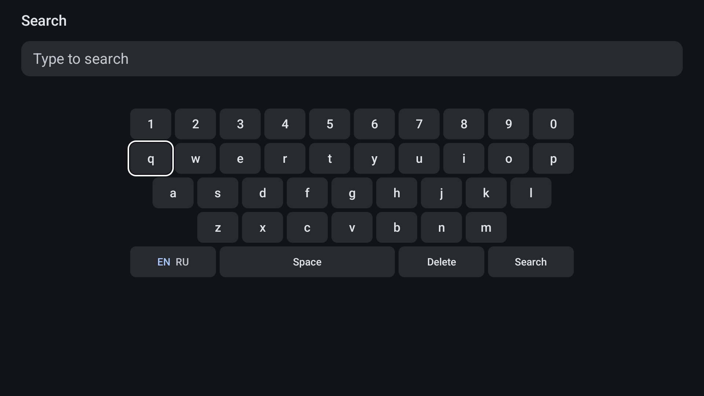
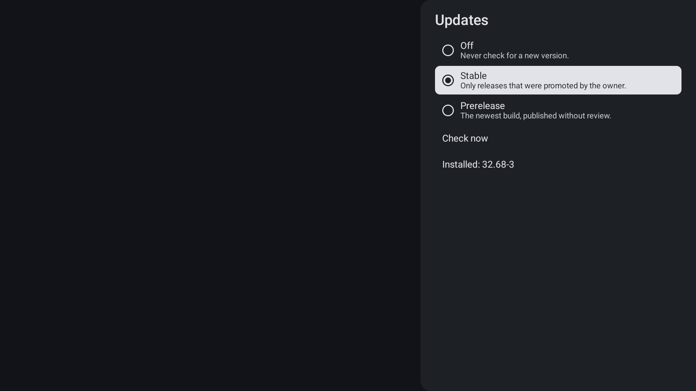

# SmartTube Material

A simple, remote-first YouTube client for Android TV and Google TV, with a new Material interface on top of
[SmartTube](https://github.com/yuliskov/SmartTube).

SmartTube's engine is excellent: account sign-in, ad blocking, SponsorBlock, and a player that handles 4K well. This fork
keeps that engine and replaces the interface with a smaller one, built with Jetpack Compose for TV.

> This is an unofficial personal project, not affiliated with or endorsed by YouTube or Google. It is also not an official
> SmartTube build: please report problems with this fork [here](https://github.com/ivanosh/SmartTube-Material/issues), not
> to the SmartTube project.

## What is different

**Navigation**
- One row of tabs across the top, instead of a drawer.
- Hold OK on a tab to make it the one that opens first, hide it, or edit the tabs.
- The section editor works with the remote alone: pick up an item, move it, press Back to save. At most 8 tabs.

**Player**
- You choose which buttons sit on the panel and in what order, up to 8; everything else stays under More.
- The original audio track plays by default, not an automatic dub. You can still change it for any video.
- The seek bar shows chapters and SponsorBlock segments in their own colours, with a legend for the ones in that video. When a video has chapters, a row of them sits below the buttons.
- When a SponsorBlock segment is skipped, a chip says so and offers Undo. While any segment plays, a Skip
  chip is there, and auto-skip learns from your choices per channel.

**Sign-in**
- A QR code opens the activation page with the code already filled in.

**Updates**
- Settings has an Updates page: Off, Stable or Prerelease, and Check now. The app checks GitHub Releases at most once a
  day, from the browse screen, and installs only a file whose checksum, package name and signing key match. There is no
  background job and no silent install.

**Light by design**
- No blur, no parallax, no autoplaying previews, no background jobs. Scrolling is tuned and measured on real sticks.

## Screenshots











Video: Big Buck Bunny (c) Blender Foundation, CC BY 3.0. See [peach.blender.org](https://peach.blender.org/).

## What comes from SmartTube

Account sign-in, ad blocking, SponsorBlock, subscriptions, history, playlists, and the playback engine. This code is
upstream's and stays close to it, so that new versions can be merged.

## Not included

Phones and tablets, casting from a phone, voice search, several accounts, comments, a Shorts section, live chat and
home screen channels. The interface is in English only. If you need these, use [SmartTube](https://github.com/yuliskov/SmartTube)
itself; the two apps install side by side.

## Install

Requires Android 10 or newer. Tested on a Chromecast with Google TV and a Skyworth 4K Google TV stick.

Download an APK from [Releases](https://github.com/ivanosh/SmartTube-Material/releases) and install it with adb. Every
release is published as a prerelease first, so take the newest entry of the list. After that, the app can update itself
(see Updates above), or you can install the next APK over it the same way:

```sh
adb connect <tv-ip>:5555
adb -s <tv-ip>:5555 install SmartTube_material_<version>_<arch>.apk
```

Check which APK your device needs with `adb shell getprop ro.product.cpu.abilist`. Installing without adb, building from
source and verifying a release are covered in the
[technical notes](https://github.com/ivanosh/SmartTube-Material/blob/material/README-Material.md).

## Privacy and your account

- Signing out or uninstalling does **not** revoke access. To revoke it, open
  [myaccount.google.com/security](https://myaccount.google.com/security), go to "Your connections to third-party apps &
  services", find YouTube TV and choose "Remove access".
- Account files are left out of local and cloud backups, and automatic backup is off by default.
- Releases are signed with this fork's own key, which is not SmartTube's. The certificate fingerprint is in the technical
  notes.

## Credits and license

All the hard parts are the work of [Yuriy Liskov (yuliskov)](https://github.com/yuliskov) and the SmartTube contributors.
If this app is useful to you, consider supporting [SmartTube](https://github.com/yuliskov/SmartTube).

MIT, like the original. See [LICENSE](https://github.com/ivanosh/SmartTube-Material/blob/material/LICENSE).
